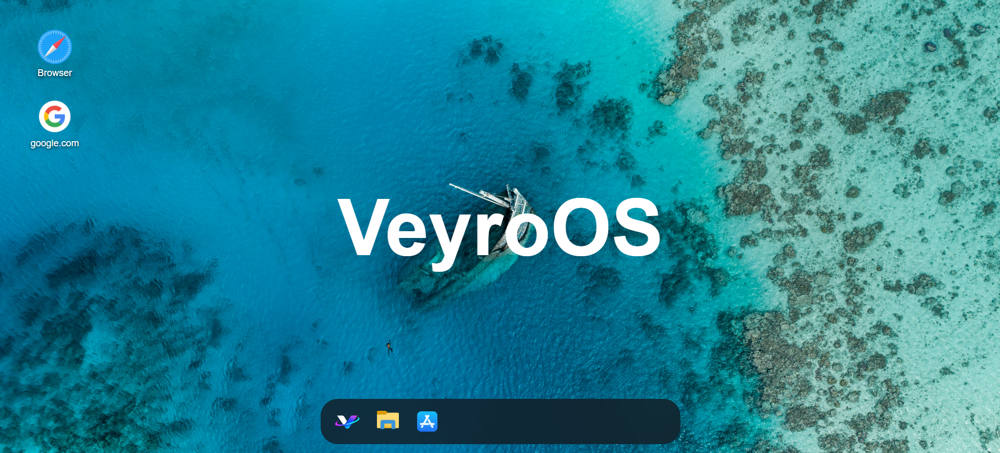
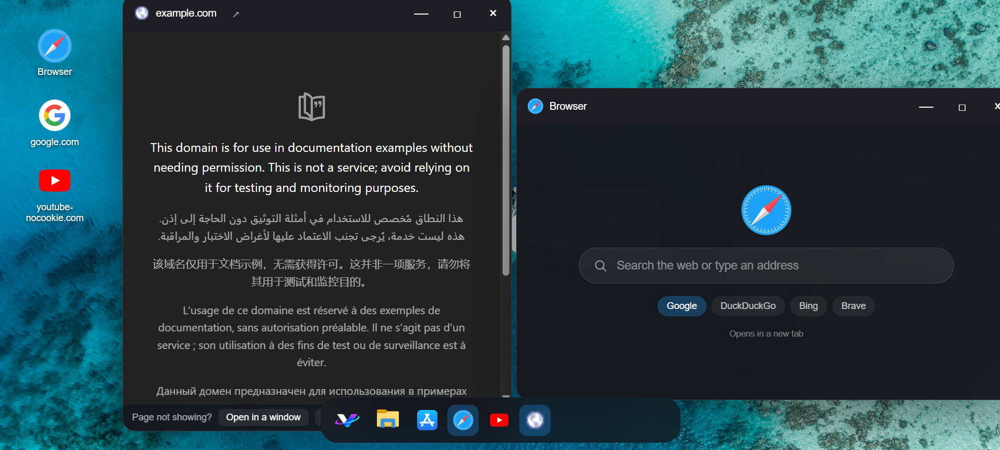
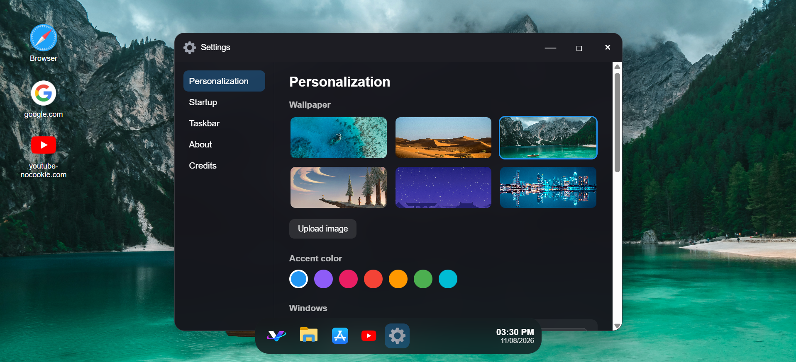
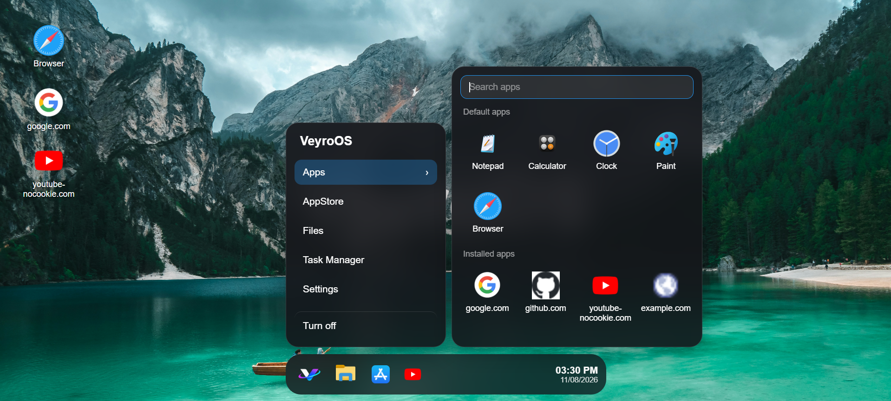

# VeyroOS

🏠 A Simple Home Page thinking of, how Windows 12 looks like!

Elevate your browsing experience with a sleek, minimalist design inspired by macOS and Windows 11. This stylish extension reimagines your new tab page, blending elegance and functionality to create a beautiful, personalized dashboard.

<a href="https://nam.safelink.emails.azure.net/redirect/?destination=https%3A%2F%2Fmicrosoftedge.microsoft.com%2Faddons%2Fdetail%2Ffmialcgggmijifbjmebnjdjmnhpfifom&p=bT05YWI2MGNhNS0xMTQxLTRlMGUtYjdjZS1jZTRhNWRjZTA5Y2MmdT1hZW8mbD1mbWlhbGNnZ2dtaWppZmJqbWVibmpkam1uaHBmaWZvbQ%3D%3D">Also Available on Edge Web Add-ons</a>

🌟 Key Features You’ll Love:

1. Drag, resize, maximize and minimize apps, with a taskbar that keeps track tabs.
2. All your apps, Files and Settings, with search.
3. Have an AppStore, add any website to VeyroOS in just one click.
4. Have personalization where you can edit Wallpapers, accent colors, light or dark mode, window styles and use your own custom cursor.[Custom cursor in in beta]
5. If site can open in tab, just click on 'open in a window' and here we're in an new tab.
6. Search effortlessly with an intuitive input bar, offering the flexibility to choose between your browser’s default search engine
7. Needs no account and no tracking. Your settings stay on your computer. Just a total safe and privacy-embedded extension.

